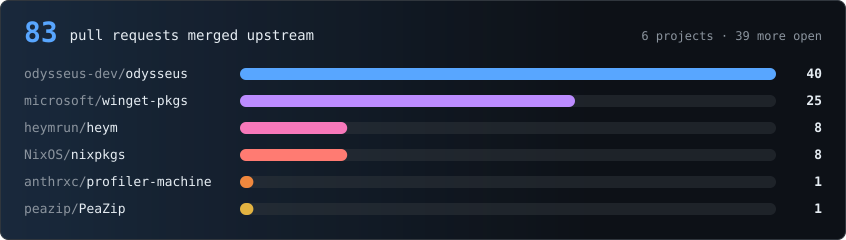

  

  
  
  
  

Recurrent / looped language models, representation-level evaluation, interpretability, latent reasoning, agent learning, and the relationship between <strong>reading</strong> an internal representation and <strong>controlling</strong> computation through it.

  
  
  
  

  

  

  <a href="https://github.com/odysseus-dev/odysseus/pulls?q=is%3Apr+author%3AVykosMolt">odysseus</a>
  ·
  <a href="https://github.com/microsoft/winget-pkgs/pulls?q=is%3Apr+author%3AVykosMolt">winget-pkgs</a>
  ·
  <a href="https://github.com/heymrun/heym/pulls?q=is%3Apr+author%3AVykosMolt">heym</a>
  ·
  <a href="https://github.com/NixOS/nixpkgs/pulls?q=is%3Apr+author%3AVykosMolt">nixpkgs</a>
  ·
  <a href="https://github.com/peazip/PeaZip/pulls?q=is%3Apr+author%3AVykosMolt">PeaZip</a>
  ·
  <a href="https://github.com/anthrxc/profiler-machine/pulls?q=is%3Apr+author%3AVykosMolt">profiler-machine</a>

  
  

<strong>13 finished or parked projects</strong>

 

| Project | What it was |
|---|---|
| **[SemABI](https://github.com/VykosMolt/semabi)** | Semantic interface induction: learning what an application does by operating it through a browser, with no source, API, schema or docs. |
| **[Curunír](https://github.com/VykosMolt/Curunir)** | An intelligence workbench that will not let a conclusion outrun its evidence. |
| **[Lifetime-Meta-Learning](https://github.com/VykosMolt/Lifetime-Meta-Learning)** | Experiments on writable recurrent representations and learning-time credit. |
| **[looped-wiki](https://github.com/VykosMolt/looped-wiki)** | Structured literature index for looped / recurrent models, organized around claims rather than documents. |
| **[JLens-Ouro](https://github.com/VykosMolt/JLens-Ouro)** | Jacobian-lens experiments against the raw logit lens inside a recurrent loop. |
| **[One-Concept-Multiple-Geometries](https://github.com/VykosMolt/One-Concept-Multiple-Geometries)** | Tests how different corpus operators recover different geometries from the same underlying concept. |
| **[omarchy-desktop](https://github.com/VykosMolt/omarchy-desktop)** | The Omarchy Quattro desktop reconstructed as an ordinary Arch Linux session. |
| **[walltone](https://github.com/VykosMolt/walltone)** | Rotates a wallpaper and restyles Kitty from the same image. |
| **[Glasshouse](https://github.com/VykosMolt/Glasshouse)** | Two offline browser mysteries at Bellwether Conservatory, 1932. Python, no dependencies, no network. |
| **[picture-books](https://github.com/VykosMolt/picture-books)** | Interactive technical picture books: *Hidden States*, *Free Fall*, and *The Red Thread*. |
| **[Ink-Handwritting-Studio](https://github.com/VykosMolt/Ink-Handwritting-Studio)** | A handwriting generator built to handle real documents. |
| **[Hunter-Seeker-v2](https://github.com/VykosMolt/Hunter-Seeker-v2)** · **[v1](https://github.com/VykosMolt/Hunter-Seeker-v1)** | Transactional non-LLM ARC-AGI-3 agent: the compact rebuild, and the earlier Stockfish-style nineteen-mixin stack. |

